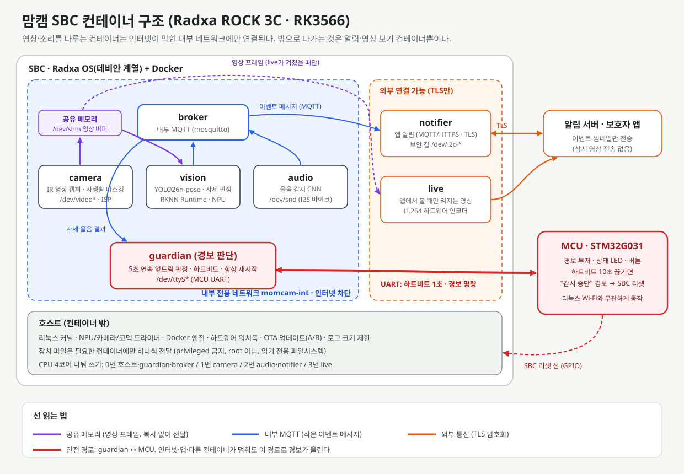

# 맘캠(MomCam) SBC 컨테이너 구조 보고서

- 작성자: 다혜
- 작성일: 2026-10-16
- 관련 문서: `report/sbc_mcu.md`(SBC·MCU 선정), `report/inference_engine.md`(추론 엔진), `report/preprocessing.md`(전처리)

> **문서 상태:** 시제품 SBC(Radxa ROCK 3C, RAM 4GB)에서 맘캠 소프트웨어를 **기능별 컨테이너(Docker)로 나눠 실행하는 구조 설계안**이다. 메모리·CPU 배분은 예상치이며 시제품에서 측정해 고친다.

---

## 1. 결론

| 항목 | 결정 |
|---|---|
| 실행 환경 | Radxa OS(데비안 계열) + Docker Engine + Docker Compose |
| 컨테이너 수 | **7개**: camera · vision · audio · guardian · broker · notifier · live |
| 내부 통신 | 영상 프레임은 **공유 메모리**, 작은 이벤트는 **내부 MQTT(broker)** |
| 네트워크 | 영상·소리를 다루는 컨테이너는 **인터넷이 막힌 내부 네트워크**에만 연결. 밖으로 나가는 것은 notifier·live뿐 |
| 안전 경로 | guardian 컨테이너 ↔ MCU(UART). 다른 컨테이너나 인터넷이 멈춰도 경보는 이 경로로 울림 |
| 컨테이너 밖(호스트) | 커널·드라이버, Docker 엔진, 하드웨어 워치독, OTA 업데이트 |



---

## 2. 왜 컨테이너로 나누는가

| 이유 | 맘캠에서의 의미 |
|---|---|
| **사생활 보호를 구조로 보장** | 영상·소리를 다루는 컨테이너에 인터넷 연결 자체가 없다. "영상은 기기 안에서만 분석한다"는 PRD 약속을 코드가 아니라 **네트워크 설정**으로 지킨다 |
| **한 기능이 죽어도 나머지는 산다** | 실시간 영상(live)이 메모리를 다 써도 경보 판단(guardian)은 따로 보장된 메모리로 계속 돈다 |
| **기능별 업데이트** | 자세 모델만 바꿀 때 vision 컨테이너만 새로 받는다. 경보 코드는 건드리지 않는다 |
| **개발 환경 = 기기 환경** | PC에서 만든 이미지를 그대로 SBC에서 실행해 "내 PC에서는 됐는데" 문제를 줄인다 |
| **권한 최소화** | 각 컨테이너는 필요한 장치 파일(카메라, 마이크, NPU, UART)만 받는다. 카메라 컨테이너는 Wi-Fi에, 알림 컨테이너는 카메라에 접근하지 못한다 |

---

## 3. 컨테이너별 역할

| 컨테이너 | 하는 일 | 받는 장치 | 네트워크 | 중요도 |
|---|---|---|---|---|
| **camera** | IR 카메라 캡처 → **사생활 마스킹(전처리 1단계)** → 5fps로 줄여 공유 메모리에 저장 | 카메라(`/dev/video*`, ISP) | 내부 전용 | 높음 |
| **vision** | 공유 메모리의 영상으로 YOLO26n-pose 추론 → 자세 4종 판정 → 결과를 MQTT로 발행 | NPU 장치 파일 | 내부 전용 | 높음 |
| **audio** | I2S 마이크 → 오디오 전처리 8단계 → 울음 감지 CNN → 결과 발행 | 마이크(`/dev/snd`) | 내부 전용 | 중간 |
| **guardian** | 자세·울음 결과를 모아 **"엎드림 5초 연속" 판정**, MCU에 경보 명령, 1초마다 하트비트 | MCU UART(`/dev/ttyS*`) | 내부 전용 | **최고** |
| **broker** | 컨테이너끼리 주고받는 내부 MQTT 서버 (밖으로 포트를 열지 않음) | 없음 | 내부 전용 | 높음 |
| **notifier** | 이벤트(엎드림 의심·울음·기기 이상)를 보호자 앱 서버로 전송, 기기 인증은 보안 칩 사용 | 보안 칩(I2C) | 내부 + **외부(TLS)** | 중간 |
| **live** | 보호자가 앱에서 볼 때만 켜져 영상을 H.264 하드웨어로 압축해 전송 | 영상 코덱 장치 | 내부 + **외부(TLS)** | 낮음 |

### 3-1. 데이터 흐름

```
[IR 카메라] → camera ──(공유 메모리, 5fps)──▶ vision ──(MQTT: posture)──┐
[마이크]   → audio ─────────────────────────────(MQTT: cry)──────────────┤
                                                                          ▼
                                                    guardian ──(UART)──▶ MCU ─▶ 부저·LED
                                                       │
                                            (MQTT: event)
                                                       ▼
                                                   notifier ──(TLS)──▶ 알림 서버 ─▶ 보호자 앱
[앱에서 영상 보기 요청] ─▶ live ◀──(공유 메모리)── camera
```

### 3-2. 내부 MQTT 주제(토픽)

| 토픽 | 보내는 쪽 → 받는 쪽 | 내용 (예시) |
|---|---|---|
| `momcam/vision/posture` | vision → guardian | `{"t": 1760600000.2, "posture": "prone", "conf": 0.91}` |
| `momcam/audio/cry` | audio → guardian | `{"t": ..., "cry": true, "conf": 0.84}` |
| `momcam/event` | guardian → notifier | `{"type": "PRONE_SUSPECT", "since": ..., "thumb": "..."}` |
| `momcam/health/<이름>` | 모든 컨테이너 → guardian | 살아 있음 신호 (5초마다) |
| `momcam/live/request` | notifier → live | 앱의 영상 보기 시작·종료 |

영상 프레임은 크기가 커서 MQTT로 보내지 않고 **공유 메모리(`/dev/shm`) 고리 버퍼**로 넘긴다. 복사가 적어 CPU를 아낀다.

---

## 4. 추론 엔진과 컨테이너의 관계

`report/inference_engine.md`에서 비교한 4개 엔진이 컨테이너 구조 안에서 어디에 쓰이는지 정리했다.

| 엔진 | 쓰는 곳 | 컨테이너 |
|---|---|---|
| **ONNX Runtime** (선택) | 개발 PC에서 FP32 기준 결과 확인, 양자화 손실 비교 | `model-tools` (개발 PC 전용, x86) — RKNN-Toolkit2와 함께 설치 |
| **RKNN Runtime** (기기 실행) | ONNX에서 변환한 INT8 모델을 NPU에서 실행 | `vision` (SBC) |
| **NCNN** (예비안) | NPU 실행이 막혔을 때 CPU로 실행 | `vision-ncnn` 이미지 (평소에는 안 씀, 같은 MQTT 토픽을 그대로 사용) |
| OpenVINO, TFLite(LiteRT) | 사용 안 함 | — |

vision 컨테이너는 **입력(공유 메모리)과 출력(MQTT 토픽)만 약속**하면 되므로, 안쪽 엔진을 RKNN에서 NCNN으로 바꿔도 guardian·notifier는 고칠 필요가 없다.

---

## 5. 자원 배분 (RAM 4GB, CPU 4코어)

| 대상 | 메모리 한도 | CPU | 비고 |
|---|---:|---|---|
| 호스트 (OS·드라이버·Docker) | 약 800MB | 0번 | 컨테이너 밖 |
| guardian | 64MB (**예약**) | 0번 | 가장 먼저 시작, 가장 높은 우선순위 |
| broker | 32MB | 0번 | |
| camera | 300MB | 1번 | 공유 메모리 버퍼 포함 |
| vision | 600MB | 1번 + NPU | 모델·추론 버퍼 |
| audio | 200MB | 2번 | |
| notifier | 128MB | 2번 | |
| live | 400MB | 3번 | 보기 요청이 있을 때만 실행 |
| **여유** | **약 1.4GB** | | 로그·업데이트 다운로드·측정 도구 |

- 메모리 한도를 넘은 컨테이너는 **그 컨테이너만** 재시작된다. guardian에는 예약 메모리를 줘서 다른 컨테이너 때문에 밀려나지 않게 한다.
- live는 기본으로 꺼 두고, 앱에서 볼 때만 켠다. 평소 CPU와 전력을 아끼고, 영상이 밖으로 나가는 시간을 줄인다.

---

## 6. 보안·안정성 설정

| 설정 | 적용 | 이유 |
|---|---|---|
| `privileged` 금지 | 전체 | 컨테이너가 기기 전체를 조작하지 못하게 함 |
| root 아닌 사용자로 실행 | 전체 | 뚫려도 피해 범위를 줄임 |
| 읽기 전용 파일시스템 | 전체 (쓰기는 지정 폴더만) | 프로그램 변조 방지, SD카드 수명 보호 |
| 필요한 장치만 전달 | 전체 | 카메라는 camera·live만, 마이크는 audio만 |
| 내부 전용 네트워크 (`internal: true`) | camera·vision·audio·guardian·broker | 영상·소리가 인터넷으로 나갈 길 자체를 없앰 |
| 이미지 버전 고정 + 서명 확인 | 전체 | 서명된 이미지만 업데이트 (PRD의 "서명된 OTA") |
| 상태 검사(healthcheck) + 자동 재시작 | 전체 | 멈추면 Docker가 다시 시작 |
| 로그 크기 제한 | 전체 | 저장소가 가득 차는 것을 막음 |

---

## 7. 고장 상황별 동작

| 상황 | 누가 알아채나 | 동작 |
|---|---|---|
| vision이 멈춤 | guardian (health 신호 끊김) | MCU에 "영상 분석 중단" 전달 → 노란 LED + 앱 알림, Docker가 vision 재시작 |
| audio가 멈춤 | guardian | 앱에 "울음 감지 중단" 알림, 재시작 (자세 감지는 계속) |
| guardian이 멈춤 | **MCU** (하트비트 끊김) | 10초 후 "감시 중단" 경보음 + 빨간 LED. Docker가 guardian 재시작 |
| Docker나 리눅스 전체가 멈춤 | **MCU** + 하드웨어 워치독 | "감시 중단" 경보 → MCU가 SBC 리셋 |
| Wi-Fi·인터넷 끊김 | notifier | 앱 알림은 다시 연결되면 보냄. **기기 경보는 그대로 동작** |
| 업데이트 실패 | 호스트 OTA | 이전 이미지 버전으로 되돌림 (A/B) |

**원칙:** 감시가 멈춘 상태를 조용히 두지 않는다. 멈추면 반드시 소리나 빛으로 알린다.

---

## 8. 시작 순서

1. **MCU** — 상시 전원으로 SBC보다 먼저 켜져 있다. 부팅 중에는 "준비 중" LED.
2. **호스트 부팅** → Docker 시작
3. **broker** → **guardian** (하트비트 시작, MCU가 "정상" 확인)
4. **camera** → **vision**, **audio** (각각 상태 검사 통과 후 다음 단계)
5. **notifier** (인터넷 연결 확인)
6. **live** — 앱 요청이 올 때만

guardian이 camera·vision보다 **먼저** 뜨는 이유: 영상 분석이 준비되지 않은 시간에도 "아직 감시 시작 전"이라는 상태를 MCU와 앱에 정확히 알리기 위해서다.

---

## 9. docker-compose.yml (요약)

```yaml
networks:
  momcam-int:
    internal: true          # 인터넷 차단
  momcam-ext: {}            # 외부 통신용

x-common: &common
  restart: always
  read_only: true
  user: "1000:1000"
  cap_drop: [ALL]
  security_opt: ["no-new-privileges:true"]
  logging: { driver: local, options: { max-size: "5m", max-file: "3" } }

services:
  broker:
    <<: *common
    image: ghcr.io/kdhye516/momcam-broker:1.0.0
    networks: [momcam-int]
    mem_limit: 32m
    cpuset: "0"

  guardian:
    <<: *common
    image: ghcr.io/kdhye516/momcam-guardian:1.0.0
    networks: [momcam-int]
    devices: ["/dev/ttyS3:/dev/ttyS3"]      # MCU UART (보드에 맞게 확인)
    mem_limit: 64m
    mem_reservation: 64m
    cpuset: "0"
    depends_on: { broker: { condition: service_healthy } }
    healthcheck: { test: ["CMD", "/app/health"], interval: 5s, retries: 2 }

  camera:
    <<: *common
    image: ghcr.io/kdhye516/momcam-camera:1.0.0
    networks: [momcam-int]
    devices: ["/dev/video0:/dev/video0"]
    volumes: ["/dev/shm/momcam:/shm"]
    mem_limit: 300m
    cpuset: "1"
    depends_on: { guardian: { condition: service_healthy } }

  vision:
    <<: *common
    image: ghcr.io/kdhye516/momcam-vision-rknn:1.0.0   # 예비안: momcam-vision-ncnn
    networks: [momcam-int]
    devices: ["/dev/dri:/dev/dri"]          # NPU 장치 (보드·드라이버에 맞게 확인)
    volumes: ["/dev/shm/momcam:/shm:ro"]
    mem_limit: 600m
    cpuset: "1"
    depends_on: { camera: { condition: service_healthy } }

  audio:
    <<: *common
    image: ghcr.io/kdhye516/momcam-audio:1.0.0
    networks: [momcam-int]
    devices: ["/dev/snd:/dev/snd"]
    mem_limit: 200m
    cpuset: "2"

  notifier:
    <<: *common
    image: ghcr.io/kdhye516/momcam-notifier:1.0.0
    networks: [momcam-int, momcam-ext]
    devices: ["/dev/i2c-1:/dev/i2c-1"]      # 보안 칩
    mem_limit: 128m
    cpuset: "2"

  live:
    <<: *common
    image: ghcr.io/kdhye516/momcam-live:1.0.0
    profiles: ["on-demand"]                 # 평소에는 실행하지 않음
    networks: [momcam-int, momcam-ext]
    volumes: ["/dev/shm/momcam:/shm:ro"]
    mem_limit: 400m
    cpuset: "3"
```

> 장치 파일 이름(`/dev/ttyS3`, `/dev/dri`, `/dev/i2c-1`)은 보드와 커널 버전에 따라 다르므로 시제품에서 확인해 고친다. 이미지 이름은 예시다.

---

## 10. 양산 칩(RV1106G3)으로 옮길 때

RV1106G3는 메모리가 256MB이고 Buildroot 기반이라 **Docker를 돌리기에는 작다.** 그래서 양산 제품에서는 컨테이너 대신 **같은 7개 기능을 일반 프로그램(프로세스)으로** 실행한다.

| 항목 | 시제품 (ROCK 3C) | 양산 (RV1106G3) |
|---|---|---|
| 실행 단위 | 컨테이너 7개 | 프로세스 7개 (시작 스크립트로 관리) |
| 내부 통신 | 공유 메모리 + 내부 MQTT | **똑같이 유지** |
| 인터넷 차단 | Docker 내부 네트워크 | 리눅스 방화벽 규칙(사용자별 차단) |
| 자동 재시작 | Docker restart | 감시 스크립트 |
| 경보·감시 | guardian ↔ MCU | **똑같이 유지** |

컨테이너로 나눠 개발해 두면 각 기능의 **입력·출력 약속(공유 메모리, MQTT 토픽, UART 메시지)** 이 이미 정해져 있어서, 양산 칩으로 옮길 때 기능 코드는 거의 그대로 쓰고 실행 방식만 바꾸면 된다.

---

## 11. 다음 단계

1. ROCK 3C에 Docker를 설치하고 broker·guardian부터 올려 MCU 하트비트를 시험한다.
2. camera → vision 공유 메모리 경로로 초당 5장 처리가 되는지, 컨테이너별 실제 메모리 사용량을 잰다 (5장 표 수정).
3. 내부 전용 네트워크에서 vision·camera가 인터넷에 접속하지 못하는지 직접 확인한다 (사생활 보호 시험).
4. vision 컨테이너를 강제로 멈춰 guardian이 5초 안에 알아채는지, guardian을 멈춰 MCU가 10초 안에 경보하는지 시험한다.

> 맘캠은 보호자를 돕는 보조 모니터링 기기이며 의료기기가 아니다.
