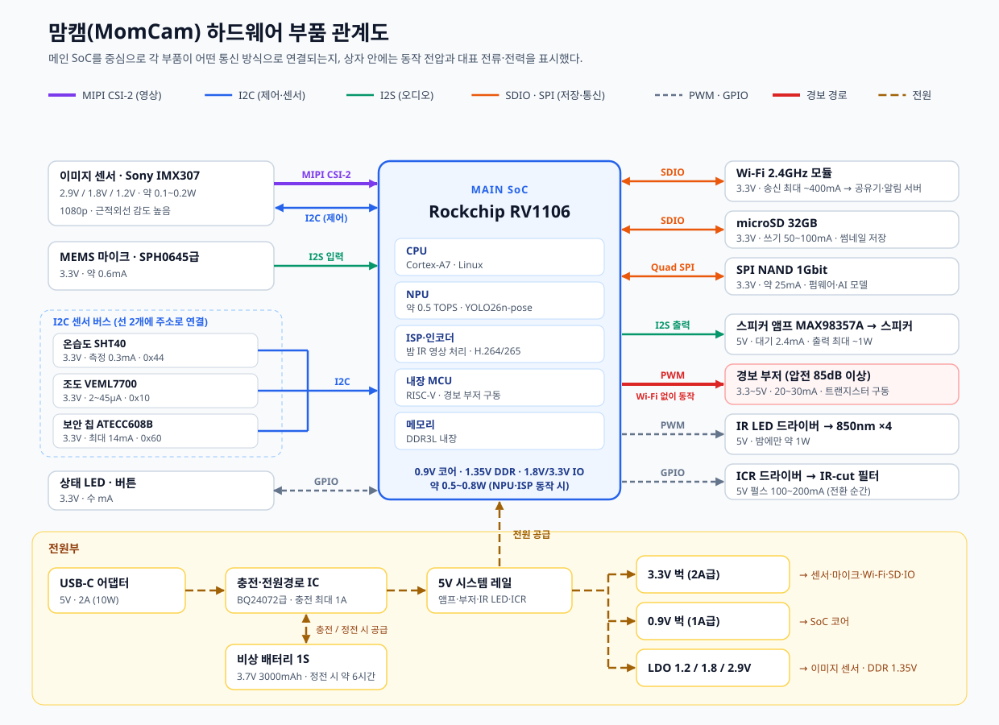

# 맘캠(MomCam) 하드웨어 부품 구성 보고서

- 작성자: 다혜
- 작성일: 2026-10-14
- 관련 문서: `PRD/PRD.md`(기술 스택), `report/model_yolo.md`(기기 탑재 AI 모델)

> **문서 상태:** 맘캠 시제품을 만들기 위한 **부품 선정안**이다. 부품명은 같은 역할을 하는 대표 부품을 예시로 든 것이고, 전압·전류는 데이터시트의 대표값(typ.) 또는 같은 급 부품의 일반적인 범위다. 실제 회로 설계 전에 최종 부품의 데이터시트로 다시 확인해야 한다.

---

## 1. 설계 조건 (PRD에서 가져온 요구사항)

| 요구사항 | 하드웨어에 주는 영향 |
|---|---|
| 1080p 영상, 밤에도 촬영 | 근적외선(NIR)에 민감한 이미지 센서 + 적외선 LED + 낮/밤 전환 필터(IR-cut) |
| 기기 안에서 AI 분석 (영상 클라우드 미전송) | NPU가 들어 있는 카메라용 SoC (YOLO26n-pose INT8 약 3MB 실행) |
| 울음 감지, 양방향 대화 | 디지털 마이크 + 스피커 앰프 |
| 엎드림 의심 시 5초 이내 **기기 자체 경보** | 큰 소리의 부저 (Wi-Fi와 무관하게 SoC가 직접 구동) |
| Wi-Fi가 끊겨도 경보 | 경보 판단과 부저 구동을 모두 기기 안에서 처리 |
| 정전 시에도 일정 시간 동작 | 리튬 배터리 + 충전·전원 경로 IC |
| 기기별 인증서, 서명된 업데이트 | 보안 칩(Secure Element) |
| 온습도 표시, 낮/밤 판단 | 온습도 센서, 조도 센서 |

---

## 2. 부품 관계도

**읽는 방법**

- **가운데 파란 상자(메인 SoC)** 가 모든 부품의 중심이다. 영상·소리·센서 값을 받아 AI로 판단하고, 부저·LED·스피커를 움직인다.
- **왼쪽은 입력 부품**(이미지 센서, 마이크, 센서 3종, 버튼)이고, **오른쪽은 저장·통신·출력 부품**(Wi-Fi, 저장소, 스피커, 부저, IR LED, IR-cut 필터)이다.
- **선의 색은 통신 방식**이다. 보라 = MIPI CSI-2(영상), 파랑 = I2C, 초록 = I2S(오디오), 주황 = SDIO·SPI, 회색 점선 = PWM·GPIO, 노랑 점선 = 전원.
- **빨간 굵은 선(SoC → 경보 부저)** 은 가장 중요한 안전 경로다. Wi-Fi나 앱과 상관없이 SoC 안의 MCU가 직접 부저를 울린다.
- **아래 노란 영역(전원부)** 은 USB-C 5V가 충전 IC를 거쳐 5V 레일이 되고, 3.3V·0.9V·LDO로 나뉘어 각 부품에 공급되는 흐름이다. 정전 시에는 배터리가 대신 공급한다.

---

## 3. 부품별 상세

### 3-1. 연산·저장

| 부품 | 예시 부품 | 역할 | 전압 | 전류·전력 (대표) | 통신 방식 |
|---|---|---|---|---|---|
| **메인 SoC** | Rockchip RV1106 (Cortex-A7 + RISC-V MCU + NPU 약 0.5 TOPS + ISP, DDR3L 내장) | 영상 처리(ISP), 전처리, YOLO 추론, 울음 분류, 경보 판단, 영상 압축(H.264/H.265) | 코어 약 0.9V, DDR 1.35V, IO 1.8V / 3.3V | 약 0.5~0.8W (NPU·ISP 동작 시) | 카메라 MIPI CSI-2, 오디오 I2S, 저장 SDIO·SPI, 센서 I2C, GPIO·PWM, 디버그 UART |
| **부팅 저장소** | SPI NAND 1Gbit (예: Winbond W25N01GV급) | 펌웨어, AI 모델, 설정 저장 | 3.3V (2.7~3.6V) | 동작 약 25mA, 대기 수십 µA | Quad SPI |
| **영상 기록 저장소** | microSD 32GB | 이벤트 썸네일·스냅샷 로컬 저장 (24시간 후 자동 삭제) | 3.3V | 쓰기 약 50~100mA | SD 4bit (SDIO) |

**SoC를 고른 이유:** NPU, 카메라 ISP, 영상 인코더, 메모리가 한 칩에 들어 있어 부품 수와 전력이 적다. 0.5 TOPS급 NPU로도 256×192 입력의 YOLO26n-pose(INT8)를 초당 5장 처리할 수 있을 것으로 예상하며, 실제 속도는 시제품에서 측정해 확인한다. 칩 안의 작은 MCU(RISC-V)는 부저·LED처럼 항상 동작해야 하는 경보 기능을 맡을 수 있다.

### 3-2. 영상 입력

| 부품 | 예시 부품 | 역할 | 전압 | 전류·전력 (대표) | 통신 방식 |
|---|---|---|---|---|---|
| **이미지 센서** | Sony IMX307 (1/2.8인치, 2MP, STARVIS) | 1080p 영상 촬영, 근적외선 감도가 높아 밤 IR 촬영에 유리 | 아날로그 2.9V, 인터페이스 1.8V, 디지털 1.2V | 약 0.1~0.2W | 영상: MIPI CSI-2 (2/4레인), 제어: I2C |
| **렌즈 + IR-cut 필터 (ICR)** | M12 광각 렌즈 + 전자식 IR-cut 필터 | 낮에는 적외선을 막아 색 왜곡 방지, 밤에는 필터를 빼 적외선 촬영 | 코일 구동 3.3~5V | 전환 순간만 약 100~200mA (0.1~0.3초 펄스) | 모터 드라이버를 거쳐 GPIO 2개로 방향 제어 |
| **ICR 구동 드라이버** | H-브리지 (예: TI DRV8837급) | 필터 코일에 양방향 전류를 흘려 필터 이동 | 로직 1.8~7V, 구동 5V | 최대 1A 이상 (ICR 코일 펄스에 충분) | GPIO (IN1/IN2) |

### 3-3. 적외선 조명

| 부품 | 예시 부품 | 역할 | 전압 | 전류·전력 (대표) | 통신 방식 |
|---|---|---|---|---|---|
| **적외선 LED ×4** | 850nm 적외선 LED | 어두운 아기방을 적외선으로 비춤 (사람 눈에는 거의 안 보임) | 순방향 전압 약 1.4~1.6V/개 | 개당 약 100mA (2개 직렬 × 2줄) | — |
| **LED 정전류 드라이버** | 정전류 LED 드라이버 IC | LED 밝기를 일정하게 유지, PWM으로 밝기 조절 | 입력 5V | LED 포함 약 1W (밤에만 동작) | PWM (밝기), GPIO (켜기/끄기) |
| **조도 센서** | Vishay VEML7700 | 방 밝기를 측정해 낮/밤 모드 자동 전환 | 2.5~3.6V (대표 3.3V) | 약 2~45µA (측정 주기에 따라), 꺼짐 0.5µA | I2C |

**850nm를 고른 이유:** 940nm는 LED의 붉은 빛이 전혀 안 보이는 장점이 있지만 센서 감도가 낮아 영상이 어둡다. 밤 IR 영상의 화질이 자세 인식 정확도에 직결되므로 850nm를 기본으로 하고, 아기 눈에 띄는 희미한 붉은 빛은 LED 위치와 확산판으로 줄인다. 적외선 LED는 영유아 눈 가까이 쓰이므로 **광생물학적 안전 기준(IEC 62471)** 확인이 필요하다.

### 3-4. 소리 입력·출력

| 부품 | 예시 부품 | 역할 | 전압 | 전류·전력 (대표) | 통신 방식 |
|---|---|---|---|---|---|
| **MEMS 마이크** | Knowles SPH0645LM4H급 디지털 마이크 | 아기 울음·주변 소리 수집 (울음 감지, 양방향 대화) | 1.62~3.6V (사용 3.3V) | 약 0.6mA | I2S (디지털 출력) |
| **스피커 앰프** | Analog Devices MAX98357A (D급 앰프) | 양방향 대화 음성, 안내음 출력 | 2.5~5.5V (사용 5V) | 대기 2.4mA, 출력 최대 약 1W 사용 (4Ω에서 최대 3.2W) | I2S (디지털 입력) |
| **스피커** | 8Ω 1W 소형 스피커 | 보호자 목소리, 자장가 출력 | 앰프 출력 | 최대 약 1W | 앰프와 아날로그 연결 |
| **경보 부저** | 압전 부저 (10cm에서 85dB 이상) | **엎드림 의심 경보**. Wi-Fi가 끊겨도 기기가 직접 울림 | 3.3~5V | 약 20~30mA | PWM (약 2.7~4kHz) → NPN 트랜지스터 구동 |

**스피커와 부저를 따로 둔 이유:** 경보는 가장 중요한 안전 기능이라, 오디오 소프트웨어나 앰프에 문제가 생겨도 울려야 한다. 부저는 SoC의 PWM 핀 하나와 트랜지스터만으로 동작하는 단순한 회로라 고장 가능성이 낮다.

### 3-5. 환경 센서·보안

| 부품 | 예시 부품 | 역할 | 전압 | 전류·전력 (대표) | 통신 방식 |
|---|---|---|---|---|---|
| **온습도 센서** | Sensirion SHT40 | 침대 주변 온도·습도 측정 (앱 표시, 쾌적 범위 알림) | 1.08~3.6V (사용 3.3V) | 측정 중 약 0.3mA, 평균 1µA 이하 | I2C |
| **보안 칩** | Microchip ATECC608B | 기기별 인증서·비밀키 보관, 서버 접속 인증, 펌웨어 서명 확인 | 2.0~5.5V (사용 3.3V) | 동작 최대 약 14mA, 대기 150nA 이하 | I2C |

**보안 칩을 넣은 이유:** 아기방 카메라는 해킹되면 사생활 피해가 크다. 비밀키를 SoC 메모리가 아니라 별도 보안 칩에 넣어 두면, 펌웨어가 유출되더라도 키를 꺼내기 어렵다. PRD의 "기기별 인증서, 서명된 OTA 업데이트" 요구사항을 하드웨어로 뒷받침한다.

### 3-6. 통신

| 부품 | 예시 부품 | 역할 | 전압 | 전류·전력 (대표) | 통신 방식 |
|---|---|---|---|---|---|
| **Wi-Fi 모듈** | 2.4GHz Wi-Fi 4 (802.11n 1T1R) SDIO 모듈 (예: Realtek RTL8189FTV급) | 보호자 앱 알림, 실시간 영상 보기, 펌웨어 업데이트 | 3.3V | 송신 최대 약 300~400mA, 수신 약 60~100mA | SDIO 4bit |

**2.4GHz를 고른 이유:** 벽을 사이에 둔 거실 공유기와 연결되는 경우가 많아, 5GHz보다 전파가 멀리 가는 2.4GHz가 유리하다. 영상은 기본적으로 기기 안에서만 분석하고, 보호자가 앱으로 볼 때만 전송하므로 대역폭 요구가 크지 않다.

### 3-7. 전원

| 부품 | 예시 부품 | 역할 | 전압 | 전류·전력 (대표) | 통신 방식 |
|---|---|---|---|---|---|
| **전원 어댑터** | USB-C 5V 2A (KC 인증 제품) | 주 전원 | 입력 AC 220V → 출력 5V | 최대 2A (10W) | — (전원 전용) |
| **충전·전원 경로 IC** | 1셀 리튬 충전 IC, 파워패스 지원 (예: TI BQ24072급) | 어댑터 전원을 시스템과 배터리에 나눠 공급, 정전 시 배터리로 자동 전환 | 입력 5V, 배터리 4.2V 충전 | 충전 최대 약 1A | 상태 핀 → GPIO (충전 중·전원 상실 감지) |
| **비상 배터리** | 1S 리튬이온 3.7V 3000mAh (보호회로 포함) | 정전 시 경보 기능 유지 | 3.0~4.2V | 약 11.1Wh | — |
| **3.3V 벅 컨버터** | 2A급 동기 벅 | 센서, Wi-Fi, IO 전원 | 입력 3.0~5.5V → 3.3V | 최대 약 1.5A | — |
| **SoC 코어 벅 컨버터** | 1A급 동기 벅 | SoC 코어 전원 | → 약 0.9V | 최대 약 1A | (필요 시 I2C 또는 GPIO로 전압 조정) |
| **LDO 레귤레이터** | 저잡음 LDO | 이미지 센서 1.8V·1.2V·2.9V, DDR 1.35V 등 | → 1.2~2.9V | 각 수십~수백 mA | — |

### 3-8. 사용자 인터페이스

| 부품 | 역할 | 전압 | 전류 | 통신 방식 |
|---|---|---|---|---|
| **RGB 상태 LED** | 전원, Wi-Fi 연결, 녹화 중, 경보 상태 표시 | 3.3V | 색당 약 2~5mA | GPIO (또는 PWM) |
| **버튼 1개** | 길게 누르면 Wi-Fi 등록 모드, 아주 길게 누르면 초기화 | 3.3V 풀업 | µA 수준 | GPIO (인터럽트) |
| **디버그 단자** | 개발·수리용 로그 확인 (제품 외부로 노출 안 함) | 3.3V | — | UART |

---

## 4. 통신 방식 정리

| 통신 방식 | 연결된 부품 | 전송하는 것 | 특징 |
|---|---|---|---|
| **MIPI CSI-2** | 이미지 센서 → SoC | 1080p 원본 영상 | 고속 차동 신호, 카메라 전용 |
| **I2C (카메라 버스)** | SoC ↔ 이미지 센서 | 노출·이득·해상도 설정 | 저속 제어용 |
| **I2C (센서 버스)** | SoC ↔ 온습도 센서(0x44), 조도 센서(0x10), 보안 칩(0x60) | 측정값, 인증 연산 | 선 2개(SDA·SCL)에 주소로 여러 부품 연결 (괄호는 기본 7bit 주소) |
| **I2S** | 마이크 → SoC, SoC → 스피커 앰프 | 디지털 오디오 (16kHz 울음 분석, 대화 음성) | 잡음에 강한 디지털 오디오 |
| **SDIO** | SoC ↔ Wi-Fi 모듈, SoC ↔ microSD | 네트워크 데이터, 썸네일 파일 | 4bit 병렬, 고속 |
| **Quad SPI** | SoC ↔ SPI NAND | 펌웨어, AI 모델 | 부팅 저장소 |
| **PWM** | SoC → IR LED 드라이버, 부저 | 밝기, 경보음 | 디지털 핀으로 세기·음 높이 조절 |
| **GPIO** | SoC → ICR 드라이버, LED / 버튼, 충전 IC → SoC | 켜기·끄기, 상태 신호 | 단순 디지털 신호 |
| **UART** | SoC ↔ 디버그 단자 | 개발용 로그 | 제품에서는 막아 둠 |
| **Wi-Fi (TLS, HTTPS/MQTT)** | 기기 ↔ 공유기 ↔ 알림 서버 | 이벤트 알림, 앱 영상 보기 | PRD의 "TLS 기반 HTTPS/MQTT"와 동일 |

---

## 5. 전력 예산

USB-C 5V 입력 기준으로 계산한 대략적인 값이다. 변환 손실을 포함해 약간 넉넉하게 잡았다.

| 항목 | 낮 (IR 끔) | 밤 (IR 켬) | 순간 최대 |
|---|---:|---:|---:|
| SoC (CPU·NPU·ISP·인코더) | 0.7W | 0.7W | 0.9W |
| 이미지 센서 | 0.15W | 0.15W | 0.2W |
| 적외선 LED + 드라이버 | 0W | 1.0W | 1.0W |
| Wi-Fi (평균 / 송신 최대) | 0.3W | 0.3W | 1.3W |
| 스피커 (대화·안내음) | 0W | 0W | 1.0W |
| 부저 (경보) | 0W | 0W | 0.15W |
| 마이크·센서·보안 칩·LED | 0.05W | 0.05W | 0.1W |
| 저장소 (microSD 쓰기 포함) | 0.1W | 0.1W | 0.3W |
| **합계** | **약 1.3W** | **약 2.3W** | **약 5.0W** |

- **어댑터 용량:** 순간 최대 약 5W에 배터리 충전(약 5W)을 더해도 **5V 2A(10W)** 어댑터로 감당할 수 있다.
- **정전 시 사용 시간:** 배터리 11.1Wh × 변환 효율 약 85% ≈ 9.4Wh. 정전 시에는 앱 영상 전송을 끄고 감지·경보만 남기는 절전 모드(밤 기준 약 1.5W)로 바꾸면 **약 6시간** 동작한다.

---

## 6. 안전·인증 고려사항

| 항목 | 내용 |
|---|---|
| **전원선 안전** | 전원 케이블은 아기 손이 닿지 않게 **침대에서 1m 이상** 떨어뜨려 설치하도록 설명서와 앱에 안내한다 (끈·케이블에 의한 질식·교살 위험). 벽 고정용 케이블 커버를 함께 제공한다. |
| **적외선 눈 안전** | 적외선 LED 세기가 영유아 눈 높이·거리에서 안전 기준(IEC 62471) 안에 드는지 확인한다. |
| **발열** | 기기 표면 온도가 높아지지 않도록 SoC에 방열판을 두고, 아기 손이 닿지 않는 높이에 설치한다. |
| **배터리 안전** | 보호회로가 있는 리튬 배터리를 쓰고, 과충전·과방전·과열 보호를 확인한다. |
| **전파·전기 인증** | 국내 판매를 위해 전파 인증(KC 적합성평가, 무선 기기 포함)과 어댑터 전기안전 인증을 받는다. |
| **작은 부품** | 버튼, 덮개 등 떨어질 수 있는 부품이 없도록 하고, 기기 전체를 침대 밖에 고정 설치한다. |

---

## 7. 다음 단계

1. 예시 부품의 최신 데이터시트로 전압·전류·핀 배치를 확인하고, 단종 여부와 구매 가능성을 점검한다.
2. RV1106 개발 보드에 이미지 센서, 마이크, 부저를 연결해 시제품을 만든다.
3. 시제품에서 **YOLO26n-pose(INT8)의 실제 처리 속도**와 **밤 IR 영상 화질**을 측정한다 (`report/model_yolo.md` 6-5 기기 실측 항목).
4. 낮·밤·정전 상황별로 실제 소비 전력을 측정해 5장의 전력 예산을 고친다.
5. Wi-Fi를 끈 상태에서 인형을 엎드려 놓고, 5초 안에 부저가 울리는지 시험한다.

> 맘캠은 보호자를 돕는 보조 모니터링 기기이며 의료기기가 아니다. 이 하드웨어 구성은 감지와 경보를 돕기 위한 설계이며, 아기의 안전을 보장하지 않는다.
